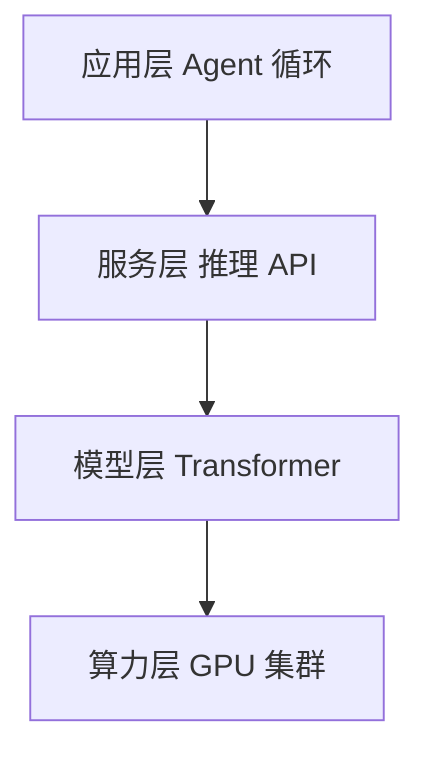
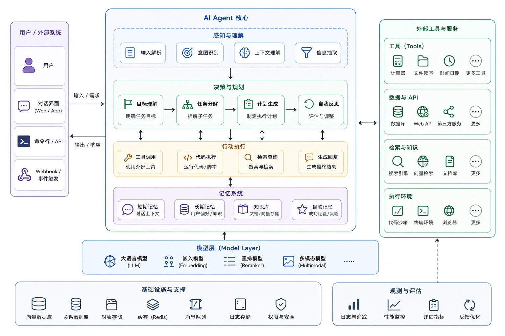
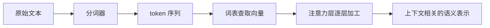
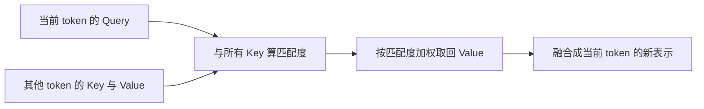
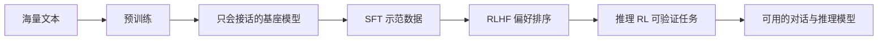
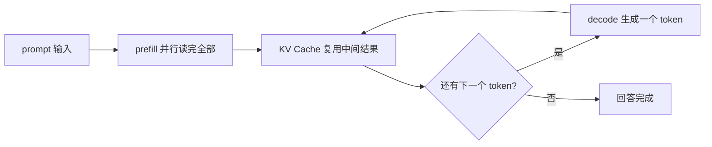
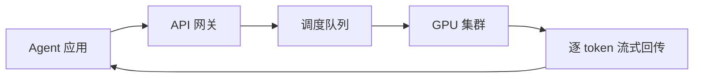
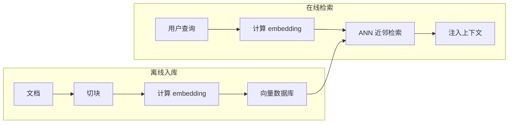

这个系列已经打穿了三层：[OpenCode 教程](/ai/2026-11-05-OpenCode入门教程/)讲**工具层**——怎么用；[《AI Agent 的核心推理逻辑详解》](/ai/2026-11-05-AI-Agent核心推理逻辑详解/)讲**认知层**——Agent 怎么想；[《AI Agent 工作原理详解》](/ai/2026-11-05-AI-Agent工作原理/)讲**系统层**——Agent 怎么跑。这篇挖到最底下：**模型本身与支撑它的基础设施**。

看完这篇你会明白：上下文窗口为什么不能无限大、API 为什么按 token 收费且输出比输入贵、Agent 为什么必须靠检索才有新知识——上层的每一个设计，根子都扎在这一层。

## 一、四层技术栈：全景定位

一个请求的完整旅程，自上而下走一遍：

1. **应用层**：Agent 循环在这里运转——组装上下文、决定调用哪个工具、消化执行结果。前三篇的主角全是它；
2. **服务层**：请求离开你的机器后第一站。网关做认证与限流，调度器决定这个请求落到哪块 GPU、和谁的请求拼在一起跑；
3. **模型层**：Transformer 神经网络本身——token 进、token 出的那台“机器”。本篇第二到五节都在讲它；
4. **算力层**：GPU 集群，所有矩阵乘法真正发生的地方。模型层的每一个性能特征，都是这层的物理约束投上去的影子。

真实产品里的完整架构比这四层更丰满。下面这张全景图（图源：[菜鸟教程](https://www.runoob.com/)）以一个 Agent 产品为中心：感知与理解、决策与规划、行动执行、记忆系统四大块组成 Agent 核心，左右两侧是用户入口与外部工具服务，底下托着模型层、基础设施与观测评估——本篇剩下的章节，就是把这张图自底向上逐层拆开：

为什么要自底向上看？因为**上层的每个设计都是对下层约束的回应**：窗口大小是注意力算力账的平衡点，按 token 计费是 GPU 时间的摊销，检索记忆是知识冻结的补丁。只看上层，这些设计像拍脑袋的产物；看到底层，它们全是必然。

## 二、Token 与 Embedding：模型眼中的世界

模型不认识文字，只认识数字。进模型之前要过两道转换：

### 分词：文本怎么变成 token

分词算法（主流是 BPE，字节对编码）的思路朴素得惊人：从字符开始，反复把语料里最高频的相邻字符对合并成更长的块，直到形成一张几万到几十万条目的词表。结果是：

- 英文常见词是一个 token，长词会切开，比如 unbelievable 可能拆成三块；
- 中文大致一到两个字符一个 token——所以同样内容中文通常比英文费 token，这也是为什么中文场景的计费和窗口压力都更高一些；
- 生僻字符、表情符号、代码里的奇怪符号会被拆成更多碎片。

token 是整个计费与容量体系的原子：上下文窗口按它计数，API 按它收费，模型按它读写。

### 嵌入：token 怎么变成向量

每个 token 被映射成一个几千维的向量。这个映射不是随便定的，而是在训练中学出来的，学出来之后有个漂亮的性质：**语义相近的词，向量在空间里也相近**。“国王”和“女王”挨得近，和“香蕉”离得远；甚至存在经典的方向性——从“国王”的向量减去“男人”加上“女人”，落点接近“女王”。

更关键的一点：同一个词在不同上下文里向量不同。“苹果发布新手机”和“早餐吃苹果”里的“苹果”，经过注意力层之后会带上完全不同的语义——向量表示是**上下文相关**的，这正是模型能理解歧义的原因。

Embedding 是整个底层架构里复用最广的发明：模型内部靠它理解语言，模型外部靠它做语义检索——第八节的 RAG 全靠它。

## 三、Transformer 与注意力：模型怎么读上下文

### 注意力在算什么

Transformer 的核心机制是注意力（Attention）。一个直白但准确的类比：每个 token 随身带三样东西——

- **Query（查询）**：一张“我在找什么”的查询单；
- **Key（键）**：一块“我能提供什么”的标签；
- **Value（值）**：真正要传递的内容。

处理某个 token 时，拿它的 Query 去和上下文里所有 token 的 Key 算匹配度，匹配越高的，其 Value 融合进来的权重越大。你读到“它”这个字时，某个注意力头会把权重压到前文的某个名词上——指代消解就是这么完成的，没有任何规则引擎参与。

### 几个必要的补充

- **多头**：这样的匹配过程并行做几十组，各组关注不同侧面——有的头盯语法结构，有的头盯指代关系，有的头盯长距离依赖。最后把各组结果拼起来；
- **位置编码**：注意力本身是“一袋子 token”，天生不知道谁前谁后，要把位置信息额外注入每个 token 的表示；
- **逐层堆叠**：注意力层叠几十层，底层大致处理语法与局部搭配，高层提炼语义与逻辑。每一层的输出都是下一层的输入，理解逐层加深。

### 上下文窗口的物理来源

注意力要求窗口内每个 token 与所有 token 两两计算——n 个 token 就是 n 的平方量级的计算量。窗口翻倍，算力开销平方级上涨，显存占用还要线性上涨。**所以上下文窗口不是产品经理拍脑袋定的数字，而是算力与显存约束下的工程平衡点**。各家模型窗口数字不同，正是因为各家在稀疏注意力、滑动窗口、KV 压缩这些工程对策上走了不同的路线。

## 四、预训练与后训练：能力从哪来

一个能干活的模型要过四道工序，每一道都在改写同一份参数：

| 阶段 | 做什么 | 得到什么 |
| --- | --- | --- |
| 预训练 | 在海量文本上玩“预测下一个 token” | 语言能力 + 世界知识 |
| 监督微调 SFT | 用人类示范的高质量问答教它“按指令行事” | 听懂指令、会对话 |
| 偏好对齐 RLHF | 用人类偏好反馈调整回答的品味 | 有用、诚实、无害 |
| 推理强化 RL | 对能验证对错的任务做强化学习 | 长思维链的深度推理 |

### 预训练：最简单的目标，最惊人的产物

预训练的任务简单到离谱：遮住文本的下一个词，让模型猜。但要把下一个 token 猜准，模型被迫学会一切——语法、事实、逻辑、代码风格、多语言翻译，全部压缩进几百亿到上万亿个参数里。代价同样惊人：万亿级 token 的训练数据、几千块 GPU 连跑数月。

### 后训练三步：从“会接话”到“好用”

预训练出来的模型只会“接话”——你说上半句它续下半句，让它写代码它可能给你续更多代码。后训练把它变成产品：

- **SFT**：几万到几十万条人工写的示范对话，教它“人该怎么用你”——回答要有结构、代码要放在代码块里、不知道该说不知道；
- **RLHF**：让模型对同一问题生成多个答案，人（或训练出来的代理评分模型）排出好坏，再据此优化。模型的“品味”——详略得当、语气得体、不瞎编——是这样调出来的；
- **推理 RL**：数学和代码这类能自动判对错的领域，让模型大量做题、答对给奖励，自己长出长思维链。新一代推理模型（深度思考模式）的来源。

### 两个必须记住的推论

1. **知识冻结在训练完成那一刻**。模型不知道今天的新闻，也没见过你的代码库——上层必须存在工具与检索的根本原因就在这里：Agent 的价值，正是给这个“知识冻结的大脑”接上实时感知与外部记忆；
2. **幻觉是架构层面的产物**。预训练优化的目标是“像”，不是“对”——下一个 token 的概率分布只管合理，不管真实。所以幻觉只能靠外挂手段缓解（检索、工具验证、要求引用来源），无法从根上消除。

## 五、推理 Inference：一次生成背后发生了什么

模型生成回答的过程叫推理（Inference），分两段，两段的瓶颈完全不同：

### Prefill：一次读完

把整段 prompt 一次性读入，所有 token 的计算**并行**进行——GPU 最擅长的活法。你发送一个很长的 prompt 后等待首字的那段时间，基本都花在 prefill 上。所以长 prompt 的首字延迟高，但读完之后的每一步都很快。

### Decode：逐字吐出

之后进入自回归循环：每一步只生成一个 token，把它接进上下文，再算下一个。要生成五百个 token 就要把模型完整过五百遍——**每生成一个 token 都要读一遍全部模型权重**，瓶颈不在算力而在显存带宽（数据从显存搬到计算单元的速度）。这就是为什么输出速度是每秒几十 token 的量级，也直接解释了 API 定价：**输入便宜、输出贵**——prefill 并行效率高，decode 又慢又费带宽。

两段对比一目了然：

| | Prefill | Decode |
| --- | --- | --- |
| 工作方式 | 整段并行一次算完 | 逐 token 自回归 |
| 瓶颈 | 算力 | 显存带宽 |
| 用户感知 | 首字延迟 | 生成速度 |
| 优化手段 | 前缀缓存、批处理 | KV Cache、量化 |

### KV Cache：用显存换时间

decode 每走一步，理论上要重算全部历史 token 的中间状态。工程上的解法是把每层每个 token 的中间结果（Key 和 Value）缓存下来复用——这就是 KV Cache。代价是它要住显存，且随上下文长度线性增长：**长上下文请求占的显存远多于参数本身**，这是长上下文 API 加价、并发上限下降的物理原因。

### 采样：为什么两次回答不一样

每一步模型输出的不是唯一答案，而是词表上每个 token 的概率分布，再按策略抽一个：

- **temperature**：控制分布的平缓度。调低，概率向最高项集中，回答稳定可复现；调高，长尾 token 也有机会，回答多样有创造性。写代码建议调低，头脑风暴调高；
- **top-p**：只在累计概率前 p 的候选里抽，动态截断长尾。

同一个问题两次回答不同，根源在此——不是模型“记不住自己说过什么”，而是每一步都在掷骰子。

## 六、算力底座：GPU 与显存

### 为什么是 GPU

Transformer 的全部计算可以归结为海量矩阵乘法，而矩阵乘法的特点是：每个输出元素的计算彼此独立、高度重复——GPU 几千个核心并行干同一类活，效率比 CPU 高几个量级。AI 的算力史，基本就是 GPU 与矩阵乘法互相成就的历史。

### 两个瓶颈，两个阶段

GPU 有两种关键资源：算力（每秒能做多少次乘加）和显存带宽（数据从显存搬进计算核心的速度）。对应到推理的两段：

- **prefill 卡算力**：大量 token 并行计算，GPU 满负荷运转；
- **decode 卡带宽**：每步只算一个 token，却要把全部权重读一遍，GPU 大部分时间在等数据。

这个诊断直接指导优化方向：prefill 阶段靠批处理提利用率，decode 阶段靠 KV Cache 和量化减少搬运量。

### 显存账本

显存里住着两样东西：

1. **模型参数**：一个 70 亿参数的模型，用半精度（FP16）存放约需 14GB——这只是“住下来”的成本；
2. **KV Cache**：随上下文长度线性增长，长上下文时轻松反超参数占用。

显存是硬约束，于是有了两条经典出路：

- **量化**：把参数从 FP16 压到 8 位甚至 4 位，显存占用减半或减到四分之一，能力略有折损——本地跑开源模型的主流思路；
- **批处理**：单个 decode 请求用不满 GPU（一直在等显存数据），把多个请求拼在一起跑，互相摊薄成本。代价是每个请求稍慢——吞吐与延迟的权衡，调度器（下一节）的日常工作就是找这个平衡点。

### 计费的经济学

把这些约束串起来，API 的价目表就完全可读了：按 token 计费，因为 GPU 时间就摊在每个 token 上；输出比输入贵，因为 decode 更慢更费带宽；长上下文加价，因为 KV Cache 多吃显存；速率限制，因为集群容量就是有限的。**计费规则不是商业策略，是算力账本的直接投影。**

## 七、服务层：Agent 与模型之间的工程

模型被包在数据中心里，你和 Agent 应用接触到的是服务层——一层“确定性工程”最密集的地方：

- **API 网关**：认证、配额、限流、计费埋点。成千上万个请求从这里过闸门；
- **调度器**：决定每个请求何时上哪块 GPU、和谁拼批。你感受到的延迟方差（有时快有时慢）大多来自这里，而不是模型本身；
- **多模型路由**：同一个 API 后面可以挂不同规模的模型——简单请求走小模型省钱，复杂请求走大模型。Agent 应用自己也可以做这层路由；
- **前缀缓存（Prompt Caching）**：相同前缀的 KV Cache 直接复用，不必每次重算。对 Agent 场景收益巨大——每轮循环的系统提示和工具定义几乎不变，缓存命中能同时省钱和降低首字延迟；
- **流式传输**：GPU 每吐一个 token，就沿着网络推到你的屏幕。上一篇讲的流式输出，物理链路是从显存一路流到浏览器；
- **容错**：超时熔断、自动重试、降级到备用模型——上层 Agent 感知不到的故障，都在这层被消化。

## 八、RAG 与向量检索：外挂记忆的底层原理

Agent 的长期记忆（工作原理篇第五节）底层靠一套向量检索系统。整个流程分离线与在线两半：

### 离线入库

文档切成块（chunk），每块算出 embedding，存进向量数据库。切块是个被低估的环节：切太碎，每块丢失上下文，检索回来读不通；切太大，一块里混了多个主题，相似度被稀释。主流做法是按语义边界（段落、标题）切，块间留少量重叠。

### 在线检索

把用户的查询也变成 embedding，在库里找向量距离最近的几块——距离用余弦相似度或点积衡量。因为语义相近的文本向量相近，检索能命中“换了说法的同一件事”，这是关键词搜索做不到的。

规模是真正的难点：百万级向量逐个比对不现实，靠**近似最近邻（ANN）索引**。两类经典思路：HNSW 在向量空间里预建一张“导航图”，查询时从入口跳着走近邻，像城市里先上高速再下匝道；IVF 先把向量聚成几千簇，查询只扫最相近的几簇。用极小的召回精度代价，换百倍的检索速度。

### 工程上的两板斧

- **混合检索**：向量检索与关键词检索（BM25）并行跑再合并——专有名词、产品型号、错误码这类查询，关键词反而更准；
- **重排（Rerank）**：先用轻量检索粗召回几十条，再用更重的模型精排出前几条。粗排求快、精排求准，两段配合。

### RAG 还是微调？

一个高频选择题：知识频繁更新、需要标注来源、跨领域通用——用 RAG；固定的技能或风格、领域术语的深层习惯——微调更合适。两者不互斥，实践中常叠加。

最后要诚实地说清边界：**检索越准，幻觉越少，但检索不到时模型仍可能编造**。成熟的系统会让模型明确说“资料里没有”，而不是硬答——这需要在提示词里显式授权“可以回答不知道”。

## 九、小结

| 概念 | 一句话 |
| --- | --- |
| 四层栈 | 应用层 → 服务层 → 模型层 → 算力层，上层设计皆源于下层约束 |
| Token | BPE 切出的最小单位，计费与窗口都按它算 |
| Embedding | 语义即向量、上下文相关，模型内理解语言、模型外做检索 |
| 注意力 | Query 配 Key 取 Value，多头分工；平方级开销定窗口上限 |
| 四道工序 | 预训练学知识，SFT 学听话，对齐学品味，RL 学深思；幻觉源于“优化像而非对” |
| 推理 | prefill 卡算力、decode 卡带宽，KV Cache 用显存换时间，采样解释随机性 |
| GPU | 显存住参数与 KV Cache，批处理摊成本，量化省显存，计费即账本 |
| 服务层 | 调度定延迟方差，前缀缓存是 Agent 的隐形红利 |
| RAG | 切块入库、向量近邻、混合检索加重排；检索不到时允许说不知道 |

至此这个系列四篇闭环：**GPU 上跑着知识冻结的 Transformer，服务层把它变成 API，Agent 循环用工具和检索给大脑接上实时感知与外部记忆，最终变成你手里的产品**。从 [OpenCode 的键位](/ai/2026-11-05-OpenCode入门教程/)到 GPU 上的矩阵乘法，每一层都清楚了。
