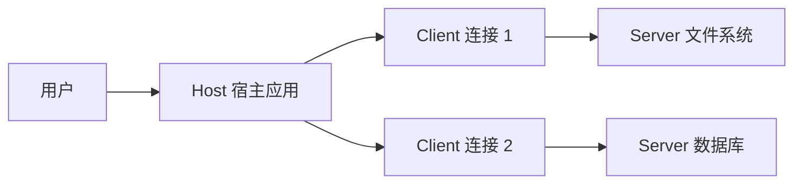
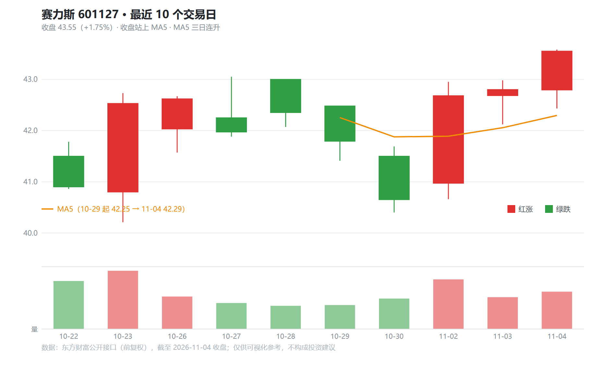

前面几篇讲过 Agent 怎么调用工具（[工作原理篇](/ai/2026-11-05-AI-Agent工作原理/)第三节），也讲过 OpenCode 的 [Skill 机制](/ai/2026-11-05-OpenCode-Skills机制详解/)。但有一个问题还没回答：**工具从哪来？** 每个产品都自己写一套文件读写、数据库查询、网页抓取，彼此不通用。MCP 就是为解决这个问题而生的协议。

## 一、问题：N 个模型 × M 个工具的集成爆炸

没有统一协议时，每个 AI 应用要接每个外部系统，都得写一遍适配代码：

- 三个 AI 客户端 × 十个数据源 = 三十套集成；
- 数据源升级一次接口，所有适配都要改；
- 工具只属于某个应用，换个客户端就得重写。

这和早年的打印机驱动一个道理：设备厂商各自为政，操作系统要为每台设备写驱动。USB 出现后，设备只要说同一种协议，所有主机都能用。**MCP 想做的就是 AI 世界的 USB-C**：工具提供方实现一次 MCP 服务器，任何支持 MCP 的客户端都能直接用。

MCP 由 Anthropic 在 2024 年底开源发布，现已被多家 AI 客户端与工具厂商采纳。它的规范公开，核心消息格式是成熟的 JSON-RPC 2.0。

## 二、三角架构：Host、Client、Server



三个角色各司其职：

- **Host（宿主）**：你直接使用的 AI 应用，如 OpenCode、Claude Desktop、IDE 插件。它负责与大模型对话、决定何时用工具、并对用户负责；
- **Client（客户端）**：Host 内部为每个 MCP 服务器建立的一条连接。一个 Host 可以同时挂多个 Client，每个 Client 独立管理自己那条连接；
- **Server（服务器）**：提供能力的一方，可以是本地进程，也可以是远程服务。它只关心“把自己的能力暴露出去”，并不知道背后是哪个模型。

这种分层的关键收益：**Server 写一次，任何 Host 都能接**；Host 不用知道每个系统的细节，只认 MCP 这一种语言。

## 三、三类能力：Tools、Resources、Prompts

Server 向外暴露的能力分为三类，区别在于**谁来决定调用**：

| 能力 | 谁来触发 | 本质 | 例子 |
| --- | --- | --- | --- |
| **Tools 工具** | 模型自主决定 | 可执行的动作，有参数、有副作用 | 查询数据库、创建 issue、发送消息 |
| **Resources 资源** | 应用或用户选择 | 可读取的数据，按 URI 寻址 | 某个文件内容、某张表的结构、某个文档 |
| **Prompts 提示模板** | 用户主动选择 | 预先写好的提示词模板，可带参数 | “按我们的规范审查这段代码” |

理解这三类的关键是**控制权**：Tools 交给模型，所以必须设计好描述与权限；Resources 让应用决定塞什么进上下文，避免模型乱读；Prompts 让用户把常用流程显式地“点”出来。这和[推理逻辑篇](/ai/2026-11-05-AI-Agent核心推理逻辑详解/)讲的上下文预算管理一脉相承：**谁有权决定进入窗口，决定了系统的安全与成本**。

此外，客户端一侧还可以向 Server 提供一些能力，如采样（让 Server 借用 Host 的模型）、根目录声明（告诉 Server 可以访问哪些路径）等，属于进阶用法。

## 四、消息与传输

### 消息格式

MCP 用 JSON-RPC 2.0：每条消息是一个带方法名和参数的 JSON 对象，请求有 id、响应带同样的 id。一次工具调用大致长这样：

``` json
{
  "jsonrpc": "2.0",
  "id": 7,
  "method": "tools/call",
  "params": {
    "name": "query_db",
    "arguments": { "sql": "SELECT count(*) FROM posts" }
  }
}
```

连接建立时还有一次能力协商：双方交换各自支持的功能，之后只使用共同支持的部分。这让协议可以平滑演进，新旧版本互不崩溃。

### 传输方式

同一套消息可以跑在不同的管道上：

- **stdio**：Host 把 Server 当成子进程启动，通过标准输入输出通信。本地工具的首选，零网络配置，权限继承自宿主进程；
- **Streamable HTTP**：远程服务的标准方式，用 HTTP 发请求、用流式响应推送结果。适合共享服务与云端能力，可以配合认证与限流；早期版本的 HTTP+SSE 方案已被它取代。

一个实用判断：**本地文件、本地命令用 stdio；团队共享的服务用远程 HTTP**。

## 五、与 Function Calling、Skill 的区别

这三个词经常被混在一起，但层次不同：

| 概念 | 层次 | 解决什么 |
| --- | --- | --- |
| **Function Calling** | 模型能力 | 模型如何输出结构化的工具调用 JSON（见[工作原理篇](/ai/2026-11-05-AI-Agent工作原理/)） |
| **MCP** | 连接协议 | 工具和数据如何被发现、描述、调用，跨应用通用 |
| **Skill** | 流程知识 | 完成某类任务的说明书，告诉模型该怎么做（见[Skills 机制篇](/ai/2026-11-05-OpenCode-Skills机制详解/)） |

一句话概括：**Function Calling 是模型的“手势”，MCP 是手和外部世界之间的“接口标准”，Skill 是“做事的步骤说明”**。三者可以叠加使用——Skill 告诉模型“先查数据库再写报告”，模型通过 Function Calling 发出调用，MCP 把调用路由到数据库服务器。

## 六、在 OpenCode 里接入 MCP 服务器

OpenCode 的 MCP 配置放在 `mcp.servers` 下。官方推荐用 CLI 添加，它会保留配置里的其他内容：

```sh
opencode mcp add <name> --global --url <remote-url>
opencode mcp list
```

- `--global` 表示对你本人所有项目生效；省略则只作用于当前项目；
- 远程服务默认使用 OAuth 登录。`mcp list` 显示“待认证”时，在 OpenCode 界面输入 `/mcps`，选中服务器后按提示登录；
- 认证凭据存放在 OpenCode 配置之外。能用 OAuth 就不要把 API Key 写进配置；确实需要时用环境变量替换，如 `{env:MCP_API_KEY}`，避免密钥入库。

接入后，服务器提供的 Tools 会和内置工具一起出现在模型的可用列表里，模型按需调用。**安全上仍要配权限**：和[权限门控](/ai/2026-11-05-AI-Agent核心推理逻辑详解/)一样，应该对会写入、会删除的工具设置 ask 或 deny，而不是放任全部放行。

接入之后能做什么，看一个真实例子。本站自己写了一个行情 MCP 服务器接入 OpenCode，会话里只说了一句“赛力斯的股价最近10日曲线绘制出来”——Agent 自主完成了三步：`search_symbol` 把“赛力斯”解析成证券代码，`get_history` 取回近 10 个交易日的行情，再按真实数据坐标渲染成 K 线图：



值得注意的不是图本身，而是**分工**：表达意图的只有一句话，数据发现、数据获取走 MCP 工具，绘图是 Agent 拿到结构化数据后用自己的代码能力完成的——外部工具负责“拿到真实世界的数据”，模型的生成能力负责“把数据变成用户要的形态”。这正是 Client 一次接入、Server 自由组合的意义。

## 七、一个典型的 MCP 服务器长什么样

以一个“查询博客文章元数据”的服务器为例，它的职责可以拆成三件事：

1. **声明工具**：`list_posts`（列出文章）、`get_post`（读取单篇），每个工具写清参数与描述；
2. **实现处理函数**：收到 `tools/call` 后执行真正的文件读取或数据库查询，结果以结构化文本返回；
3. **返回可行动的错误**：找不到文章时返回“未找到 slug 为 xxx 的文章，可先调用 list_posts 查看”，而不是一段裸堆栈——这和[工具流水线](/ai/2026-11-05-AI-Agent工作原理/)里讲的错误归一化是同一个道理。

官方提供了 TypeScript、Python 等 SDK，把上面三步封装成几十行代码即可跑起来。

## 八、小结

| 概念 | 一句话 |
| --- | --- |
| MCP | AI 世界的统一接口标准，工具写一次、处处可用 |
| 三角架构 | Host 调度、Client 管连接、Server 提供能力 |
| Tools / Resources / Prompts | 模型决定 / 应用选择 / 用户点选 |
| 传输 | 本地 stdio，远程 Streamable HTTP |
| 与其他概念的关系 | Function Calling 是手势，MCP 是接口，Skill 是步骤说明 |
| 实战 | `opencode mcp add` 接入，OAuth 登录，写操作务必设权限 |

系列现在有七篇：从[大语言模型基础](/ai/2026-11-05-大语言模型基础/)出发，到工具层的 [OpenCode](/ai/2026-11-05-OpenCode入门教程/)、[Skills](/ai/2026-11-05-OpenCode-Skills机制详解/) 与本篇 MCP——工具从哪来、怎么用、怎么管，三者在这里闭环。
