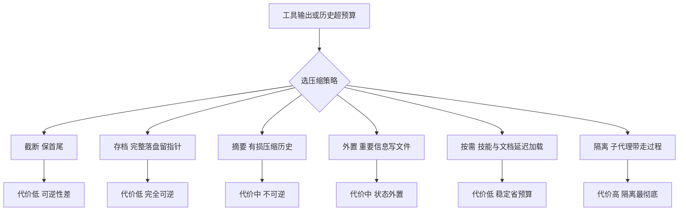
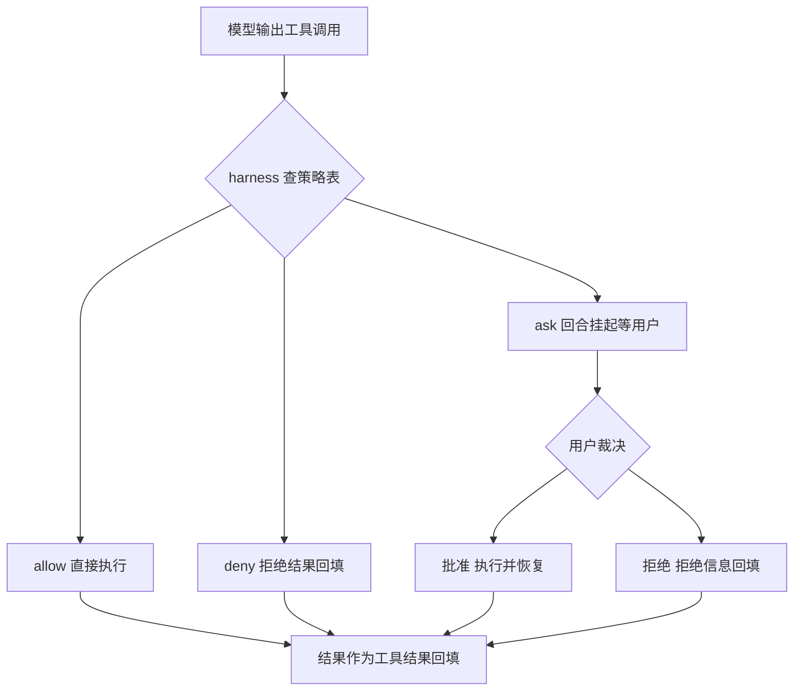
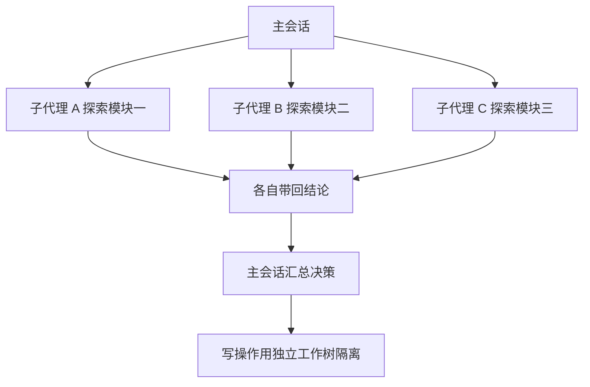

前面几篇讲过 [Agent 的工作原理](/ai/2026-11-05-AI-Agent工作原理/)和 [AI 的底层架构](/ai/2026-11-05-AI底层架构详解/)，但有一个角色一直藏在幕后没有正式介绍：**harness**——包在模型外面的那层工程壳。你天天在用的 Claude Code、OpenCode 这类编码代理，本质都是“一个模型 + 一个 harness”。

这个主题值得单独写一篇，因为它和模型本身一样重要：同样的模型，配不同水平的 harness，体验差距是代差级的。这篇文章把 harness 当作一个正经的工程对象来讲，讲它的职责边界、核心机制和设计原则。

## 一、起点：模型是无状态函数

先建立一个最基本的心智模型。大语言模型本质上是这样一个函数：

**tokens 进，tokens 出，调用结束，什么都“忘了”。**

它没有文件系统，不能执行命令，跨轮次没有记忆，也不知道你的公司规矩。你在对话里感觉到的“它记得我刚才说的话”，是 harness 每轮把历史重新拼进上下文的功劳；你感觉到的“它会改文件”，是 harness 把它输出的一小段结构化文本真正落到磁盘的功劳。

所以 harness 的设计哲学可以压缩成一句话：

**模型负责推理，harness 负责状态。**

凡是模型“记不住、够不着、碰不得”的事，都应该是 harness 的代码，而不是 prompt 里的一句叮嘱。这句哲学是后文所有机制的根。

## 二、四项核心职责

harness 包在模型外面，做四件事：

1. **上下文组装**——把世界编译成 token。系统提示、项目记忆、对话历史、工具结果，每轮拼成一个“信息三明治”发给模型。
2. **工具执行**——把模型的意图变成真实副作用。模型输出“我要读这个文件”，harness 真的去读，再把结果塞回去。
3. **权限门控**——在自主和安全之间刹车。哪些事模型可以直接做，哪些要人点头，哪些永远不许做。
4. **生命周期管理**——维持一个可持续运行的循环。会话、恢复、日志、配置热重载。

前三项各自展开就是第三节到第六节的内容，先从最核心的上下文组装说起。

## 三、上下文组装：信息三明治与 cache 经济学

### 三明治的分层

每一轮发给模型的内容，看起来是一段连续文本，实际上是精心拼装的分层结构：

- **系统提示**：harness 注入的工具说明、行为规则，位于最顶部，几乎不变
- **项目记忆**：比如 `AGENTS.md`，harness 发现项目时自动读取并注入
- **对话历史**：此前所有轮次，包括每一次工具调用和它的结果
- **新输入**：本轮的用户消息和工具输出

有个容易被忽略的细节：**分层信息不是“记住”的，而是每轮重新装配的**。会话开头的那些规则说明、`AGENTS.md` 的内容，都不在模型的“记忆”里——模型没有记忆——而是 harness 在拼装时重新附加的。这就是为什么改了 `AGENTS.md` 立刻生效，也是为什么重要约束要写进文件而不是在对话里说一次。

### 三种成本叠加

上下文的问题不是“容量够不够”这一个维度，而是三种成本叠加：

1. **硬限制**：窗口满了直接失败
2. **经济成本**：每轮重发全部历史，费用随轮次增长。定价表里 `cache read` 比普通输入便宜一个量级——如果每轮请求的前缀和上一轮完全一致，就能命中 KV cache，前缀部分几乎免费
3. **注意力质量**：历史越长越脏，模型检索关键事实的准确率越低

第三种成本最隐蔽也最致命。“给模型尽量多的事实”和“给它噪声”之间只隔一条线。harness 的上下文策略，本质上是在这三种成本之间找平衡。

### cache 友好性是拼装顺序的约束

既然 cache 按前缀命中，**拼装顺序本身就成了工程决策**：稳定的内容（系统提示、`AGENTS.md`、工具 schema）在前，易变的内容（工具结果、用户消息）在后。每轮前缀变化，cache 就全 miss。

会话进行中不时出现的系统提醒就是这种设计的产物：以固定格式、固定位置注入新信息，既补充了状态，又尽量少破坏前缀。这是“既要又要”的典型手法。

## 四、压缩策略：从截断到子代理

历史会无限增长，窗口不会。harness 手里有一整套压缩策略，按代价从低到高排：

### 截断

工具输出超长时只保留头尾，中间挖掉。最廉价，适合日志、目录列表这类“首尾有信息量、中间重复”的内容。缺点是对 JSON、代码这类结构化内容会拦腰截断语法。

### 存档降级

输出过大时，完整结果写到文件，上下文里只留预览和文件路径，模型需要时按需取回。这是我最推崇的策略：**把上下文当 cache，把文件系统当真正的存储**。它无损、可逆，而且把“要不要细看”的决定权交还给了模型。

### 摘要压缩

历史逼近预算时，把早期轮次请模型摘要，然后丢弃原文。这是**不可逆的有损压缩**，所以关键问题是：摘要里必须存活什么？

- 硬约束（踩过坑总结出的规则）
- 已做的决策及其理由
- 关键路径、文件名、地址
- 未完成任务清单

必须扔掉的是：工具输出的原始内容（可重新获取）、失败尝试的细节、探索过程。

摘要的不可逆性还派生出一条配套纪律：**压缩之后，凡是“我之前看过”的事实都要重新验证才能引用**。记忆里“我读过某个文件”不可信，重新读一次的成本，远低于引用一段失真记忆的代价。

### 分层记忆

更彻底的思路：重要信息从一开始就不进对话历史，直接写文件。

- 持久层：`AGENTS.md`，跨会话注入
- 会话层：计划文件、任务清单，会话内可反复重读
- 临时层：一次性的分析结论，落盘即弃

模型每轮“想起来”的方式不是回忆，而是**重新读文件**。这样压缩时对话历史可以随便扔——真正的记忆在磁盘上。

### 渐进披露

技能系统就是为此设计的：每个技能只以一行描述的形式常驻上下文，命中时才把几千 token 的正文加载进来。文档同理——按需拉取，永不常驻。上下文里的每一行都要“配得上”它占的预算。

### 子代理即压缩

让子代理去读五十个文件，主会话只收一段结论。搜索过程的几十万 token 被隔离在子代理的一次性上下文里，用完即弃。这是最昂贵的压缩，也是唯一能处理“探索面完全未知”任务的压缩。

### 一张图看完

## 五、权限门控：中断与恢复协议

### 权限是协议，不是弹窗

权限检查最容易被想成“执行前弹个窗确认”。但工程上正确的理解是：**权限检查发生在工具调用的传输路径上，是会话状态机里的显式状态**。

完整的状态流：

两个设计点最容易被做错。

**第一，拒绝是数据，不是异常。** 模型收到“用户拒绝执行 X”作为工具结果，它能把这条信息纳入推理、换一条路。如果拒绝表现为抛异常，模型只知道“失败了”，不知道“被否了”，会倾向于原样重试。好的 harness 让每条控制流路径都以数据形式回馈给模型。

**第二，挂起点必须是持久状态。** 用户可能十分钟后才点批准，这期间进程可能重启。所以待确认的工具调用必须和会话一起持久化，恢复时从中断处继续——这也是 harness 采用 client-server 架构的必要性之一：状态在后台服务里，不在易失的界面进程里。

### 策略的三个来源

权限规则按严格程度分三层：

1. **配置层**：结构化的允许、询问、拒绝规则，可按工具名和参数模式匹配。机器执行的硬策略。
2. **提示词层**：写在项目记忆里的规矩，比如“提交前必须先询问”。这不是代码强制的，模型**可以**违反——它是软策略，靠模型对指令的服从。
3. **运行时授权**：用户回答“总是允许”，授予一个范围授权。

分层的意义在于：能用硬策略表达的不要靠自觉，硬策略表达不了的才留在提示词层。像“展示 diff 摘要并等待同意”这种需要语义理解的确认，就只能靠提示词层——但它可以下沉为“凡是 commit 命令一律询问”的硬规则加提示词的组合。

### 不对称原则

好的权限体系是不对称的：**读便宜，写贵，不可逆的必须门控**。

- 读文件、搜索：几乎总是放行，成本低且无副作用
- 写文件、执行命令：询问或范围授权
- 推送、删除、对外发布：永远询问，即使有授权也要展示内容

风险定价不看动作大小，看**能不能撤销**。推送是不可逆副作用，语义级确认无法自动化，所以“展示改动、等待明确同意”必须保留在人这一侧。

## 六、子代理：用分形换上下文

### 子代理是一次远程调用

spawn 一个子代理，实质上是发起一次 RPC：

- **入参**：一段自包含的任务描述，可选指定底层模型
- **出参**：一段结论性文本
- **副作用**：子代理在自己的子会话里的一切工具调用，不进主会话历史

“自包含”是硬要求。子会话从**全新的空白上下文**开始，看不到主会话说过的一切。所以写子代理任务描述的手艺类似写好的 issue：背景、目标、约束、验收标准，一样不能少。任务描述就是子代理唯一的世界观来源。

### 会话延续

子代理不是一次性函数。通过会话 ID 可以继续对话一个已存在的子代理，包括运行中的。这把它从“一问一答”升级成**有状态的长协作者**：先派一个探索任务，回来后让它基于同一份上下文做下一步，省去重新装配背景的成本。

### 并发的两种模式

**扇出扇入**：独立任务分给多个子代理并行跑，主会话收齐结论后汇总。调度纪律的核心是**无共享状态**——两个子代理不能同时改同一个文件，否则就是数据竞争。真要隔离写操作，就用独立的工作树：每个子代理一个 git worktree，物理上不可能冲突。

**主会话不空等**：子代理后台运行时，父会话应该继续做不重叠的工作，而不是轮询等待。成熟的 harness 把这做成事件驱动——子代理完成时主动通知父会话。轮询不仅浪费，还会把子代理的中间输出灌进主会话上下文，破坏了隔离的初衷。

### 深度的代价

子代理还能再 spawn 子代理吗？多数 harness 允许，但每深一层，信息保真度都在衰减——任务描述被转述、结论被压缩，像传话游戏。而且深度嵌套让调试变成噩梦：一个错误结果要从最里层往外追。实践约束通常是深度不超过两层，且最里层必须是只做不判断的机械任务。

### 失败也是数据

子代理失败时返回的不是异常，是“它做了什么、卡在哪”的描述。父会话的职责是把失败信息纳入推理后决定：换思路重派（带上“上次为什么失败”的教训）、自己接手、还是放弃。这和权限一节的“拒绝是数据”是同一个哲学。

## 七、生命周期：client-server 与可观测性

### 分离的架构

以 OpenCode 为例：界面只是客户端，后台服务拥有会话、配置、插件、权限和工具执行。这样设计带来三个直接好处：

- 会话可恢复，界面进程崩溃不丢状态
- 多客户端（终端、编辑器插件）共享同一个后台
- 配置热重载，改完即生效，不用重启

### 可观测性的分层

排查问题时，第一步永远是定位“问题属于客户端、共享服务还是单个项目”。所以日志要按角色分层：客户端启动日志、服务侧的会话日志、工具执行日志、权限裁决日志，各记各的。出问题时按层过滤，而不是在一锅粥里捞。

## 八、三条底层原则

把前面所有机制收拢，其实是三条原则在反复出现：

**原则一：状态外置。** 记忆在文件里，会话在服务里，大输出在磁盘里——上下文只放 cache。成熟 harness 的演进方向都是这个：换模型、换会话、崩溃恢复，都不丢东西。

**原则二：控制流数据化。** 拒绝、失败、后台完成通知，全都以消息的形式回填给模型，而不是抛异常。模型始终保有决策权，harness 提供事实。

**原则三：不可逆即门控。** 风险定价不看动作大小，看能否撤销。读放行、写询问、不可逆的永远把确认留在人这一侧。

## 九、小结

回到开头那张图：搁浅的船体和撑着它的缆绳支架。模型是船——推理能力再强，下不了水也是一堆木头；harness 是那套支架、缆绳和工具——不显眼，但决定了这条船能不能出海、出多远的海。

几条带走的话：

- **评估一个编码代理，别只看模型，看 harness**：上下文策略是否精细、权限是否分层、子代理是否隔离，这三点决定同样的模型是好用还是难用
- **写项目记忆文件（`AGENTS.md`）就是在给 harness 喂策略**：凡是踩过坑的约束都写进去，它们每轮都会被重新装配，比对话里说一次可靠得多
- **模型负责推理，harness 负责状态**——这句话可以用来检验任何一个代理产品的设计：如果一个“记忆”功能只存在于 prompt 里而落不了盘，它迟早会丢

相关阅读：[AI-Agent 工作原理](/ai/2026-11-05-AI-Agent工作原理/)、[AI 底层架构详解](/ai/2026-11-05-AI底层架构详解/)、[Skills 机制详解](/ai/2026-11-05-OpenCode-Skills机制详解/)、[AI 的自我改进](/ai/2026-11-08-AI的自我改进/)。
