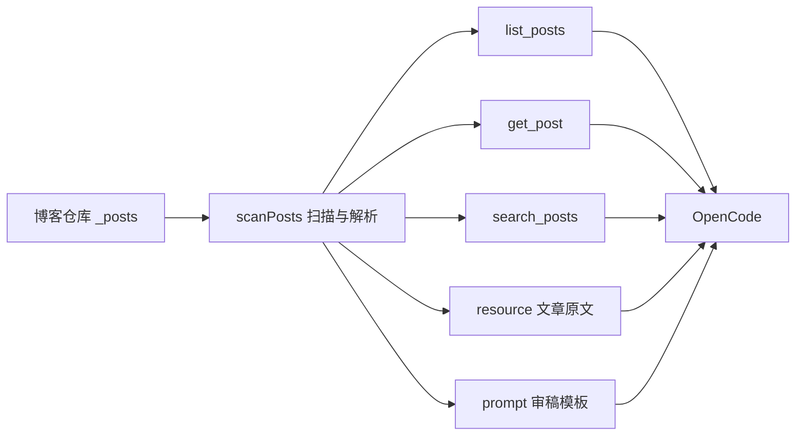

上一篇 [MCP 协议详解](/ai/2026-11-05-MCP协议详解/) 把协议本身讲清楚了：三角架构、三类能力、JSON-RPC 与传输方式。但第七节只画了一个博客文章服务器的轮廓，没有一行能运行的代码。这一篇把它补完——从空目录开始，写一个真正能接进 OpenCode 的 MCP 服务器，再把过程中值得记的坑逐个摊开。

成品提供五个入口：三个工具（列文章、读文章、搜文章）、一个资源模板（按 URI 读原文）、一个提示模板（审稿）。选博客做数据源有两个原因：数据就在手边，不需要外部 API；读操作没有副作用，可以把注意力放在协议与工程上，而不是权限设计。

语言选 TypeScript，是因为博客的构建链本来就在 Node 上，服务器可以顺手读取仓库里的 Markdown。Python 的 FastMCP 思路完全一样，换语言不影响协议部分。

## 一、先选对 SDK

动手前先确认版本，这一步比写代码更重要。MCP 的 TypeScript SDK 在 2026 年 7 月完成了一次大版本换代，今天能搜到的教程，大半还是 v1 的写法。

| | v1 | v2 |
| --- | --- | --- |
| npm 包 | `@modelcontextprotocol/sdk` | `@modelcontextprotocol/server` 与 `@modelcontextprotocol/client` |
| 支持的规范 | 到 2025-11-25 | 2026-07-28 |
| 状态 | 维护线，至少到 2027 年 1 月 | 当前稳定版 |
| 启动方式 | 手写 `StdioServerTransport` 再 `connect` | `serveStdio` 接收工厂函数 |
| 工具注册 | `registerTool` | `registerTool`，参数 schema 用 `z.object` 包裹 |

两个包不能混用。v1 和 v2 各有一个叫 `McpServer` 的类，名字相同、实现不同，混装经常表现为“类型检查通过、运行时报错”。判断方法很简单：打开 `package.json`，看装的是哪个包。

兼容性不必担心。v2 的 `serveStdio` 默认把 2025 时代的握手当作正常连接处理（`legacy` 选项默认是 `serve`），只支持旧协议的 Host 也能连上来。我用 OpenCode 2.3.2 实测通过，第六节有完整过程。

版本信息以写作时的 npm 最新版为准：`@modelcontextprotocol/server` 2.4.0、`@modelcontextprotocol/sdk` 1.32.2。SDK 迭代很快，动手前先 `npm view` 确认一眼。

## 二、十分钟：最小可运行服务器

初始化项目：

``` sh
mkdir blog-posts-mcp
cd blog-posts-mcp
npm init -y
npm pkg set type=module
npm install @modelcontextprotocol/server zod
```

Node 需要 20 以上，SDK 的 `engines` 字段写的是 `>=20`。`type: module` 是为了用 ESM 的 `import`。

新建 `src/server.js`，二十几行就是一个完整服务器：

``` js
import { McpServer } from '@modelcontextprotocol/server';
import { serveStdio } from '@modelcontextprotocol/server/stdio';
import { z } from 'zod';

function createServer() {
  const server = new McpServer({ name: 'hello', version: '0.1.0' });

  server.registerTool(
    'hello',
    {
      title: '打招呼',
      description: '向指定的人问好，用来验证服务器是否跑通。',
      inputSchema: z.object({
        name: z.string().default('世界').describe('要问候的名字'),
      }),
      annotations: { readOnlyHint: true },
    },
    async ({ name }) => ({
      content: [{ type: 'text', text: `你好，${name}！` }],
    }),
  );

  return server;
}

serveStdio(() => createServer());
```

拆开看只有四件事：

- `new McpServer({ name, version })`：这两个字段会在 `initialize` 响应里回给客户端，也会出现在 `mcp list` 和日志里，起名要能一眼看出用途；
- `registerTool(name, config, handler)`：第一个参数是模型看到的工具名，习惯用下划线命名；`description` 决定模型什么时候调用它；`inputSchema` 是 Zod schema，SDK 会转成 JSON Schema 随 `tools/list` 发出去；
- handler 的参数已经过校验和默认值填充，返回 `CallToolResult`。`content` 数组是给模型看的内容，最常见的是 `text` 类型；
- `serveStdio(() => createServer())` 接收的是工厂函数，不是实例。每个客户端连接会拿到独立的服务器实例，连接之间不共享状态；以后加缓存或计数器时，这一点很关键。

参数校验发生在进入 handler 之前。模型给 `name` 传了数字，SDK 直接返回参数错误，handler 根本不会执行。这比在函数里手写 `if` 可靠得多。

## 三、数据层：把博客目录变成数据源

博客的文章不在一个目录里，而是按分类分开：

``` text
knight-boy.github.io/
├── ai/_posts/
├── algorithm/_posts/
├── cplusplus/_posts/
├── master/_posts/
└── origin/_posts/
```

每篇是带 front matter 的 Markdown：

``` md
---
title: "MCP 协议详解"
date: 2026-11-05
description: >
  讲清 MCP 的三角架构与三类能力。
---

正文……
```

服务器要做三件事：扫描目录、解析 front matter、按 id 读取单篇。新建 `src/blog.js`，先写解析器：

``` js
export function parseFrontMatter(raw) {
  const match = raw.match(/^---\r?\n([\s\S]*?)\r?\n---\r?\n?([\s\S]*)$/);
  if (!match) return { data: {}, body: raw };

  const data = {};
  const lines = match[1].split(/\r?\n/);
  for (let i = 0; i < lines.length; i++) {
    const kv = lines[i].match(/^([A-Za-z_][\w-]*):\s*(.*)$/);
    if (!kv) continue;
    const [, key, value] = kv;
    if (value === '>' || value === '|') {
      const block = [];
      while (i + 1 < lines.length && /^\s+/.test(lines[i + 1])) {
        block.push(lines[++i].trim());
      }
      data[key] = value === '>' ? block.join(' ') : block.join('\n');
    } else {
      data[key] = value.replace(/^["']|["']$/g, '');
    }
  }
  return { data, body: match[2] };
}
```

这是够用版：只处理 `key: value`、`>` 折叠块和 `|` 保留块，不支持嵌套与数组。本站的 front matter 很简单，二十多行足够；如果 front matter 有嵌套结构，直接上 `gray-matter`，不要自己写 YAML 解析器。

分类清单放在 `CATEGORIES` 常量里（`['ai', 'algorithm', 'cplusplus', 'master', 'origin']`），扫描时逐个进入。摘要缺失时取正文第一段，由 `firstParagraph` 处理，完整代码见附录。

接着扫描五个分类目录，收集元数据并按日期倒序：

``` js
export async function scanPosts(root) {
  const posts = [];
  for (const category of CATEGORIES) {
    let files;
    try {
      files = await readdir(join(root, category, '_posts'));
    } catch (error) {
      if (error.code === 'ENOENT') continue;
      throw error;
    }
    for (const file of files) {
      if (!file.endsWith('.md')) continue;
      const raw = await readFile(join(root, category, '_posts', file), 'utf8');
      const { data, body } = parseFrontMatter(raw);
      posts.push({
        id: `${category}/${file.slice(0, -3)}`,
        category,
        file,
        title: String(data.title ?? file),
        date: String(data.date ?? ''),
        description: String(data.description ?? firstParagraph(body)).slice(0, 160),
      });
    }
  }
  return posts.sort((a, b) => (a.date < b.date ? 1 : a.date > b.date ? -1 : 0));
}
```

单篇读取按 id 定位，id 的形式是 `分类/文件名去掉扩展名`，例如 `ai/2026-11-05-MCP协议详解`：

``` js
export async function readPost(root, id) {
  const slash = id.indexOf('/');
  const category = slash === -1 ? '' : id.slice(0, slash);
  const name = slash === -1 ? '' : id.slice(slash + 1);
  if (!CATEGORIES.includes(category) || !name || name.includes('..') || name.includes('\\') || name.includes('/')) {
    throw new Error(`无效的文章 id：${id}。格式应为 <分类>/<文件名去掉 .md>`);
  }
  const raw = await readFile(join(root, category, '_posts', `${name}.md`), 'utf8');
  const { data, body } = parseFrontMatter(raw);
  return {
    id,
    category,
    title: String(data.title ?? name),
    date: String(data.date ?? ''),
    description: String(data.description ?? ''),
    raw,
    body,
  };
}
```

这里有一个必须认真对待的细节：**id 来自模型**。模型可能被诱导传入 `ai/../../../etc/passwd` 这样的值，如果直接拼进路径，服务器就会把系统文件读出来。代码用两道检查堵住：分类必须在白名单里，文件名不允许出现 `..`、斜杠和反斜杠。更稳妥的做法是在 `path.resolve` 之后确认结果仍位于文章目录内，作为第二道防线。

## 四、三个工具：让模型一次选对

工具的设计目标不是“功能齐全”，而是“让模型一次选对”。判断标准有三条：名字能看懂、描述说清何时用、参数有边界。下面的注册代码都在 `createServer` 函数里，省略了外层的函数定义；`BLOG_ROOT`、`categorySchema` 和 `formatPostLine` 是文件顶部的小工具，完整代码见附录。

### list_posts：先给模型一张地图

``` js
  server.registerTool(
    'list_posts',
    {
      title: '列出博客文章',
      description: '按日期倒序列出博客文章，可按分类过滤。返回每篇文章的 id、标题、日期与摘要。',
      inputSchema: z.object({
        category: categorySchema.optional(),
        limit: z.number().int().min(1).max(50).default(10).describe('最多返回几篇'),
      }),
      annotations: { readOnlyHint: true },
    },
    async ({ category, limit }) => {
      const posts = await scanPosts(BLOG_ROOT);
      const picked = posts.filter((post) => !category || post.category === category).slice(0, limit);
      if (picked.length === 0) {
        return { content: [{ type: 'text', text: '没有匹配的文章。' }] };
      }
      return { content: [{ type: 'text', text: picked.map(formatPostLine).join('\n') }] };
    },
  );
```

几个刻意的选择：

- `category` 用 `z.enum` 而不是 `z.string`，生成的 JSON Schema 会带 `enum`，客户端能渲染成下拉选项，模型也不容易编造不存在的分类；
- `limit` 有上限 50 和默认值 10。工具返回的内容会进入上下文，不设上限等于把上下文预算交给模型的自觉；
- 返回 Markdown 列表而不是 JSON。同样的信息，列表少一层括号和引号，模型读起来更稳；
- `readOnlyHint: true` 告诉宿主这个工具只读。它只是提示，不是强制，但宿主可以据此放宽权限门控。

### get_post：错误要能让模型自我修正

``` js
  server.registerTool(
    'get_post',
    {
      title: '读取博客文章',
      description: '按 id 读取一篇文章的完整 Markdown 原文，包含 front matter。',
      inputSchema: z.object({
        id: z.string().describe('文章 id，例如 ai/2026-11-05-MCP协议详解'),
      }),
      annotations: { readOnlyHint: true },
    },
    async ({ id }) => {
      try {
        const post = await readPost(BLOG_ROOT, id);
        return { content: [{ type: 'text', text: post.raw }] };
      } catch (error) {
        return {
          content: [{ type: 'text', text: `读取失败：${error.message}` }],
          isError: true,
        };
      }
    },
  );
```

注意错误分支：找不到文章时返回 `isError: true` 的结果，而不是抛异常。两者在协议层完全不同：

| 处理方式 | 客户端看到 | 适用场景 |
| --- | --- | --- |
| 抛异常 | JSON-RPC 错误，`tools/call` 失败 | 参数结构错误、服务器内部故障 |
| `isError: true` | 正常的工具结果，带错误文本 | 业务错误，模型可以换参数重试 |

路径写错、id 不存在属于第二类。把“读取失败：无效的文章 id”放进结果里，模型下一轮就会先调 `list_posts` 查正确 id；如果直接抛错，很多宿主只显示一条红色报错，对话就断了。

### search_posts：用检索换上下文

``` js
  server.registerTool(
    'search_posts',
    {
      title: '检索博客文章',
      description: '按关键词全文检索博客文章，多个关键词用空格分隔。返回命中的文章及上下文片段。',
      inputSchema: z.object({
        query: z.string().min(1).describe('关键词，多个用空格分隔'),
        limit: z.number().int().min(1).max(20).default(5),
      }),
      annotations: { readOnlyHint: true },
    },
    async ({ query, limit }) => {
      const hits = await searchPosts(BLOG_ROOT, query, limit);
      if (hits.length === 0) {
        return { content: [{ type: 'text', text: `没有找到包含「${query}」的文章。` }] };
      }
      const text = hits
        .map((hit) => `- [${hit.id}] ${hit.title}（相关度 ${hit.score}）\n  ${hit.snippet}`)
        .join('\n');
      return { content: [{ type: 'text', text }] };
    },
  );
```

检索本身很朴素：按空格切词，标题命中记 5 分、摘要 2 分、正文 1 分，最后按分数排序。没有向量库，也没有分词器——对一百多篇文章的博客，这已经够快够准。真实项目里把 `searchPosts` 换成 SQLite FTS 或嵌入检索即可，工具签名不用变。

返回片段而不是全文，是为了控制上下文。片段两端的省略号是 `slice` 截出来的窗口，不是文章真的这么写。

三个工具的分工：

| 工具 | 输入 | 返回 | 典型调用时机 |
| --- | --- | --- | --- |
| `list_posts` | 分类、数量 | 标题、日期、摘要 | 不知道有哪些文章 |
| `get_post` | 文章 id | 完整 Markdown | 已经定位到具体一篇 |
| `search_posts` | 关键词 | 命中列表与片段 | 只记得主题，不记得标题 |

## 五、资源与提示：另外两类能力

Tools 之外，MCP 还有两类能力。它们不是锦上添花，而是把控制权交还给应用和用户。

### Resource：把文章变成可寻址的数据

``` js
  // 资源：把每篇文章暴露成可寻址的 URI，由客户端决定何时塞进上下文
  server.registerResource(
    'post',
    new ResourceTemplate('blog://posts/{category}/{file}', {
      list: async () => {
        const posts = await scanPosts(BLOG_ROOT);
        return {
          resources: posts.map((post) => ({
            uri: `blog://posts/${post.category}/${encodeURIComponent(post.file)}`,
            name: post.title,
            mimeType: 'text/markdown',
          })),
        };
      },
    }),
    {
      title: '博客文章原文',
      description: '按 URI 读取某篇文章的完整 Markdown 原文',
      mimeType: 'text/markdown',
    },
    async (uri, { category, file }) => {
      const name = decodeURIComponent(String(file)).replace(/\.md$/, '');
      const post = await readPost(BLOG_ROOT, `${category}/${name}`);
      return { contents: [{ uri: uri.href, text: post.raw, mimeType: 'text/markdown' }] };
    },
  );
```

- 第一个参数 `post` 是服务器内部的资源名，不对外；
- `ResourceTemplate` 定义 URI 的形状。`{category}` 和 `{file}` 是两个变量，读取时由宿主填值；
- `list` 回调让 `resources/list` 能枚举所有文章。没有它也能按 URI 读，但客户端不知道有哪些资源可读；
- 读取回调必须把请求的 `uri.href` 原样放进 `contents`，客户端靠它匹配响应。

中文文件名在这里埋了一个坑：URI 里的非 ASCII 字符会被百分号编码，`resources/read` 拿到的 `file` 变量也是编码后的。所以读取前要 `decodeURIComponent`，否则拼出来的文件名永远找不到。

另一个容易忽略的点是 `mimeType`。声明成 `text/markdown`，宿主就知道这是文本，可以预览或直接塞进上下文；声明错了，客户端可能当成二进制拒绝展示。

### Prompt：把流程固化成模板

``` js
  // 提示模板：用户主动选择，把常用流程固化成一次调用
  server.registerPrompt(
    'review_post',
    {
      title: '审阅博客文章',
      description: '读取指定文章，按博客规范检查结构、引号、mermaid 与互链，输出修改清单。',
      argsSchema: z.object({
        id: z.string().describe('文章 id，例如 ai/2026-11-05-MCP协议详解'),
      }),
    },
    async ({ id }) => {
      const post = await readPost(BLOG_ROOT, id);
      const instructions = [
        '你是博客的技术编辑。请审阅下面的文章，只输出问题清单，不要重写全文。',
        '检查项：',
        '1. front matter 是否包含 title/date/modified/description/author/comments；',
        '2. 中文正文是否误用了直引号；',
        '3. mermaid 节点标签是否含有括号、撇号或反引号；',
        '4. 章节是否从「一、」连续编号；',
        '5. 是否缺少与系列其他文章的互链。',
        '',
        `文章 id：${id}`,
        '',
        post.raw,
      ].join('\n');
      return { messages: [{ role: 'user', content: { type: 'text', text: instructions } }] };
    },
  );
```

Prompt 和 Tool 的区别不在实现，而在触发者：工具由模型决定调用，提示模板由用户主动选择。`review_post` 把“审稿”这件事写成固定指令——检查 front matter、直引号、mermaid 风险字符、章节编号、互链——用户选中它、填入文章 id，就得到一份按规范检查过的提示，不用每次手打。

`argsSchema` 里的 `id` 会成为 `prompts/get` 的参数。宿主通常把它渲染成表单；参数缺失时由 SDK 校验并报错。

三类能力到齐后，服务器的结构是这样：



## 六、接进 OpenCode 实测

代码写完，接进真实的 Host 才算数。OpenCode 添加本地服务器的命令是：

``` sh
opencode mcp add blog-posts -- node /绝对路径/blog-posts-mcp/src/server.js /绝对路径/knight-boy.github.io
```

`--` 后面的部分原样作为子进程命令。第一个路径是服务器脚本，第二个是博客仓库根目录——服务器通过命令行参数拿到数据源，而不是把路径写死在代码里。省略 `--global` 时，配置写进当前项目的 `opencode.json`：

``` json
{
  "mcp": {
    "servers": {
      "blog-posts": {
        "type": "local",
        "command": ["node", "/绝对路径/blog-posts-mcp/src/server.js", "/绝对路径/knight-boy.github.io"]
      }
    }
  }
}
```

注意结构是 `mcp.servers.<名字>`。OpenCode V1 的写法是把服务器名直接放在 `mcp` 下面，从旧文章复制配置会失效。

``` text
$ opencode mcp list
✓ blog-posts  connected
✓ stocks      connected
✓ weather     connected
✓ WebSearch   connected
```

connected 只说明握手成功，还得看模型会不会用。第一个测试：

``` text
> 用 blog-posts 工具列出 ai 分类最新的 3 篇文章

execute {"code":"return await tools[\"blog-posts\"].list_posts({ category: \"ai\", limit: 3 })"}
AI 生态观测：GitHub 星榜上的 Agent 地图（2026-11-19）
Harness 工程：编码代理框架的架构与设计（2026-11-15）
AI 的思考之谜：推理链、验证器与规划的边界（2026-11-10）
```

OpenCode V2 把 MCP 工具挂在 `tools['blog-posts']` 命名空间下，模型通过代码调用。这行工具调用是它自己生成的，不是我指定的。

第二个测试把两个工具串起来：

``` text
> 先用 search_posts 搜索 MCP 协议，再用 get_post 读取命中的第一篇文章，最后告诉我这篇文章有几个二级标题

execute {"code":"const res = await tools[\"blog-posts\"].search_posts({ query: \"MCP 协议\", limit: 5 }); return res;"}
execute {"code":"const post = await tools[\"blog-posts\"].get_post({ id: \"ai/2026-11-05-MCP协议详解\" }); ..."}
搜索结果：最匹配的是 ai/2026-11-05-MCP协议详解（相关度 14）
读取：143 行
二级标题：共 8 个
```

模型先检索定位、再读取全文、最后自己数标题——工具只提供数据，组合推理发生在模型侧。这正是协议篇说的分工：服务器负责把真实数据交出去，不替模型做决定。

实测中遇到一个小问题：在全新目录里直接跑 `opencode mcp list`，可能显示 `No MCP servers configured`，即使 `opencode.json` 已经写好。先在该目录启动一次 OpenCode 会话，项目级配置才会被后台服务加载。配置本身没写错，别急着重装。

## 七、调试与排错

### stdout 是协议通道

stdio 传输把 stdout 当成 JSON-RPC 管道。任何 `console.log` 都会在消息之间插入一行普通文本，客户端的 JSON 解析器读到这里就崩了。症状通常是连接刚建立就断开，或者报一个莫名其妙的解析错误。

规则只有一条：**日志一律走 stderr**。`serveStdio` 的 `onerror` 回调也一样：

``` js
serveStdio(() => createServer(), {
  onerror: (error) => console.error('[blog-posts]', error),
});
```

`console.error` 走 stderr，不污染协议，调试时可以放心加。

### 返回体量要有上限

`get_post` 返回全文，一篇文章几千字，折合几千 token。模型如果连着读三篇，上下文就去掉一大半。演示服务器可以这样，生产环境要加两个约束：工具描述里写明“读取整篇，仅在确定 id 后调用”；实现上支持 `offset` 与 `limit` 分页，或者对超长文章截断并提示剩余长度。

`list_posts` 的 `limit` 上限也是同一件事。上下文是预算，服务器是预算的第一道闸门。

### 描述是给模型的 UI

把工具描述写成“这是列表工具”没有用。模型需要的是：什么时候用、参数填什么、返回什么。对比一下：

- 差：列出文章。
- 好：按日期倒序列出博客文章，可按分类过滤。返回每篇文章的 id、标题、日期与摘要。

第二版里，“按日期倒序”暗示结果顺序，“可按分类过滤”告诉模型有这个维度，“返回 id”告诉它下一步能拿 id 调 `get_post`。工具描述是模型选工具时唯一的信息来源，值得多花几分钟写。

### 用 Inspector 做冒烟测试

官方 Inspector 2.x 支持纯命令行模式，不用打开网页：

``` sh
npx @modelcontextprotocol/inspector --cli node src/server.js /path/to/blog --method tools/list --strict
npx @modelcontextprotocol/inspector --cli node src/server.js /path/to/blog --method tools/call --tool-name list_posts --tool-arg category=ai --tool-arg limit=3
```

`--strict` 会检查工具 schema 的可移植性问题。接宿主之前先跑一遍，能把“某个客户端不认这个 schema”的问题提前暴露。Inspector 2.16 对 Node 小版本要求较严，出现 `EBADENGINE` 警告时功能通常仍然正常。

### 权限不能只靠注解

`readOnlyHint` 是给宿主的提示，不是沙箱。只读工具可以放宽，写操作必须在宿主侧配置 ask 或 deny；更根本的做法是让服务器本身不提供危险能力——需要删文件就单独做一个工具，而不是在“读文章”里加一个 `delete` 参数。

## 八、小结

| 层次 | 本文的实现 | 验证方式 |
| --- | --- | --- |
| 工具 | `list_posts`、`get_post`、`search_posts` | OpenCode 会话实际调用 |
| 资源 | `blog://posts/{category}/{file}` | `resources/list`、`resources/read` |
| 提示 | `review_post` | `prompts/list`、`prompts/get` |
| 传输 | stdio | `opencode mcp list` 显示 connected |
| 兼容 | v2 SDK + legacy 客户端 | OpenCode 2.3.2 实测 |

再往前一步是远程化：把 stdio 换成 Streamable HTTP，加上鉴权、限流和日志，服务器就能给团队共用。SDK 提供了 `createMcpHandler` 处理 HTTP 侧；传输换了，工具、资源、提示的注册代码一行不用改——这就是协议分层的价值。

回头看，这个服务器没有一行“聪明”的代码：扫描目录、解析 front matter、关键词匹配，全是笨办法。MCP 服务器本来就不需要聪明，它需要的是**边界清楚**：参数有校验、错误可行动、路径不越界、日志不串台。把这些做到，模型才能放心地把工具当成手，而不是当成又一个需要提防的接口。

系列相关文章：

- [MCP 协议详解](/ai/2026-11-05-MCP协议详解/)：协议本身，本文的前作
- [OpenCode 入门教程](/ai/2026-11-05-OpenCode入门教程/)：Host 侧怎么用
- [Skills 机制详解](/ai/2026-11-05-OpenCode-Skills机制详解/)：流程知识怎么组织
- [AI Agent 工作原理](/ai/2026-11-05-AI-Agent工作原理/)：工具调用的上游机制

## 附：完整代码

`src/blog.js`：

``` js
import { readdir, readFile } from 'node:fs/promises';
import { join } from 'node:path';

export const CATEGORIES = ['ai', 'algorithm', 'cplusplus', 'master', 'origin'];

/** 解析 YAML front matter：只处理本站用到的标量、> 与 | 折叠块。 */
export function parseFrontMatter(raw) {
  const match = raw.match(/^---\r?\n([\s\S]*?)\r?\n---\r?\n?([\s\S]*)$/);
  if (!match) return { data: {}, body: raw };

  const data = {};
  const lines = match[1].split(/\r?\n/);
  for (let i = 0; i < lines.length; i++) {
    const kv = lines[i].match(/^([A-Za-z_][\w-]*):\s*(.*)$/);
    if (!kv) continue;
    const [, key, value] = kv;
    if (value === '>' || value === '|') {
      const block = [];
      while (i + 1 < lines.length && /^\s+/.test(lines[i + 1])) {
        block.push(lines[++i].trim());
      }
      data[key] = value === '>' ? block.join(' ') : block.join('\n');
    } else {
      data[key] = value.replace(/^["']|["']$/g, '');
    }
  }
  return { data, body: match[2] };
}

export function firstParagraph(body) {
  return body
    .split(/\r?\n\r?\n/)
    .map((p) => p.trim())
    .find((p) => p && !p.startsWith('#') && !p.startsWith('```') && !p.startsWith('!')) ?? '';
}

/** 扫描各分类目录下的 _posts，按日期倒序返回元数据。 */
export async function scanPosts(root) {
  const posts = [];
  for (const category of CATEGORIES) {
    let files;
    try {
      files = await readdir(join(root, category, '_posts'));
    } catch (error) {
      if (error.code === 'ENOENT') continue;
      throw error;
    }
    for (const file of files) {
      if (!file.endsWith('.md')) continue;
      const raw = await readFile(join(root, category, '_posts', file), 'utf8');
      const { data, body } = parseFrontMatter(raw);
      posts.push({
        id: `${category}/${file.slice(0, -3)}`,
        category,
        file,
        title: String(data.title ?? file),
        date: String(data.date ?? ''),
        description: String(data.description ?? firstParagraph(body)).slice(0, 160),
      });
    }
  }
  return posts.sort((a, b) => (a.date < b.date ? 1 : a.date > b.date ? -1 : 0));
}

/** 读取单篇文章。id 形如 ai/2026-11-05-MCP协议详解。 */
export async function readPost(root, id) {
  const slash = id.indexOf('/');
  const category = slash === -1 ? '' : id.slice(0, slash);
  const name = slash === -1 ? '' : id.slice(slash + 1);
  if (!CATEGORIES.includes(category) || !name || name.includes('..') || name.includes('\\') || name.includes('/')) {
    throw new Error(`无效的文章 id：${id}。格式应为 <分类>/<文件名去掉 .md>`);
  }
  const raw = await readFile(join(root, category, '_posts', `${name}.md`), 'utf8');
  const { data, body } = parseFrontMatter(raw);
  return {
    id,
    category,
    title: String(data.title ?? name),
    date: String(data.date ?? ''),
    description: String(data.description ?? ''),
    raw,
    body,
  };
}

/** 关键词检索：标题命中权重最高，其次摘要，最后正文。 */
export async function searchPosts(root, query, limit = 5) {
  const terms = query.toLowerCase().split(/\s+/).filter(Boolean);
  if (terms.length === 0) return [];

  const hits = [];
  for (const meta of await scanPosts(root)) {
    const post = await readPost(root, meta.id);
    const title = meta.title.toLowerCase();
    const description = meta.description.toLowerCase();
    const body = post.body.toLowerCase();
    let score = 0;
    for (const term of terms) {
      if (title.includes(term)) score += 5;
      if (description.includes(term)) score += 2;
      if (body.includes(term)) score += 1;
    }
    if (score === 0) continue;
    const at = body.indexOf(terms[0]);
    const snippet = at === -1 ? meta.description : post.body.slice(Math.max(0, at - 40), at + 80).replace(/\s+/g, ' ');
    hits.push({ ...meta, score, snippet: `…${snippet.trim()}…` });
  }
  return hits.sort((a, b) => b.score - a.score).slice(0, limit);
}
```

`src/server.js`：

``` js
#!/usr/bin/env node
import { McpServer, ResourceTemplate } from '@modelcontextprotocol/server';
import { serveStdio } from '@modelcontextprotocol/server/stdio';
import { z } from 'zod';
import { CATEGORIES, readPost, scanPosts, searchPosts } from './blog.js';

/** 博客仓库根目录：环境变量 > 命令行参数 > 当前目录。 */
const BLOG_ROOT = process.env.BLOG_ROOT ?? process.argv[2] ?? process.cwd();

const categorySchema = z.enum(CATEGORIES).describe('分类目录名');

function formatPostLine(post) {
  return `- [${post.id}] ${post.title}（${post.date}）\n  ${post.description}`;
}

function createServer() {
  const server = new McpServer({ name: 'blog-posts', version: '1.0.0' });

  server.registerTool(
    'list_posts',
    {
      title: '列出博客文章',
      description: '按日期倒序列出博客文章，可按分类过滤。返回每篇文章的 id、标题、日期与摘要。',
      inputSchema: z.object({
        category: categorySchema.optional(),
        limit: z.number().int().min(1).max(50).default(10).describe('最多返回几篇'),
      }),
      annotations: { readOnlyHint: true },
    },
    async ({ category, limit }) => {
      const posts = await scanPosts(BLOG_ROOT);
      const picked = posts.filter((post) => !category || post.category === category).slice(0, limit);
      if (picked.length === 0) {
        return { content: [{ type: 'text', text: '没有匹配的文章。' }] };
      }
      return { content: [{ type: 'text', text: picked.map(formatPostLine).join('\n') }] };
    },
  );

  server.registerTool(
    'get_post',
    {
      title: '读取博客文章',
      description: '按 id 读取一篇文章的完整 Markdown 原文，包含 front matter。',
      inputSchema: z.object({
        id: z.string().describe('文章 id，例如 ai/2026-11-05-MCP协议详解'),
      }),
      annotations: { readOnlyHint: true },
    },
    async ({ id }) => {
      try {
        const post = await readPost(BLOG_ROOT, id);
        return { content: [{ type: 'text', text: post.raw }] };
      } catch (error) {
        return {
          content: [{ type: 'text', text: `读取失败：${error.message}` }],
          isError: true,
        };
      }
    },
  );

  server.registerTool(
    'search_posts',
    {
      title: '检索博客文章',
      description: '按关键词全文检索博客文章，多个关键词用空格分隔。返回命中的文章及上下文片段。',
      inputSchema: z.object({
        query: z.string().min(1).describe('关键词，多个用空格分隔'),
        limit: z.number().int().min(1).max(20).default(5),
      }),
      annotations: { readOnlyHint: true },
    },
    async ({ query, limit }) => {
      const hits = await searchPosts(BLOG_ROOT, query, limit);
      if (hits.length === 0) {
        return { content: [{ type: 'text', text: `没有找到包含「${query}」的文章。` }] };
      }
      const text = hits
        .map((hit) => `- [${hit.id}] ${hit.title}（相关度 ${hit.score}）\n  ${hit.snippet}`)
        .join('\n');
      return { content: [{ type: 'text', text }] };
    },
  );

  // 资源：把每篇文章暴露成可寻址的 URI，由客户端决定何时塞进上下文
  server.registerResource(
    'post',
    new ResourceTemplate('blog://posts/{category}/{file}', {
      list: async () => {
        const posts = await scanPosts(BLOG_ROOT);
        return {
          resources: posts.map((post) => ({
            uri: `blog://posts/${post.category}/${encodeURIComponent(post.file)}`,
            name: post.title,
            mimeType: 'text/markdown',
          })),
        };
      },
    }),
    {
      title: '博客文章原文',
      description: '按 URI 读取某篇文章的完整 Markdown 原文',
      mimeType: 'text/markdown',
    },
    async (uri, { category, file }) => {
      const name = decodeURIComponent(String(file)).replace(/\.md$/, '');
      const post = await readPost(BLOG_ROOT, `${category}/${name}`);
      return { contents: [{ uri: uri.href, text: post.raw, mimeType: 'text/markdown' }] };
    },
  );

  // 提示模板：用户主动选择，把常用流程固化成一次调用
  server.registerPrompt(
    'review_post',
    {
      title: '审阅博客文章',
      description: '读取指定文章，按博客规范检查结构、引号、mermaid 与互链，输出修改清单。',
      argsSchema: z.object({
        id: z.string().describe('文章 id，例如 ai/2026-11-05-MCP协议详解'),
      }),
    },
    async ({ id }) => {
      const post = await readPost(BLOG_ROOT, id);
      const instructions = [
        '你是博客的技术编辑。请审阅下面的文章，只输出问题清单，不要重写全文。',
        '检查项：',
        '1. front matter 是否包含 title/date/modified/description/author/comments；',
        '2. 中文正文是否误用了直引号；',
        '3. mermaid 节点标签是否含有括号、撇号或反引号；',
        '4. 章节是否从「一、」连续编号；',
        '5. 是否缺少与系列其他文章的互链。',
        '',
        `文章 id：${id}`,
        '',
        post.raw,
      ].join('\n');
      return { messages: [{ role: 'user', content: { type: 'text', text: instructions } }] };
    },
  );

  return server;
}

serveStdio(() => createServer(), {
  onerror: (error) => console.error('[blog-posts]', error),
});
```
