## mermaid 是什么

[Mermaid](https://mermaid.js.org/) 是一个"用文本画图"的工具：像写代码一样写下结构描述，浏览器直接渲染成流程图、时序图、甘特图等。本文的所有示例**都是真的会渲染**——只要在每个示例开头三四个反引号后写 `mermaid`，再写图的描述即可。

本站已内置 mermaid 支持，特性：

- 写作时用 " ```mermaid ... ``` " 围栏，无需插件；
- 页面打开或翻页导航后自动渲染；
- 跟随夜/日主题自动换配色（暗色下重新着色）；
- 图保持自然宽度，宽图窄屏时横向滚动，不缩字；
- CDN 不通或图语法写错时，自动降级为普通代码块显示源码。

## 流程图

流程图最常用，`flowchart TD` 表示自上而下（`TB` 同义），`LR` 从左到右。

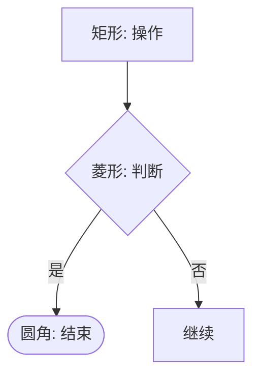

节点形状速查：

| 写法 | 形状 | 语义建议 |
|---|---|---|
| `A[文本]` | 矩形 | 普通步骤 |
| `B(文本)` | 圆角 | 起止点 |
| `C([文本])` | 体育场形 | 强调的起止 |
| `D{文本}` | 菱形 | 判断/分支 |
| `E[(文本)]` | 圆柱 | 数据库 |
| `F((文本))` | 圆形 | 连接点 |
| `G>文本]` | 旗形 | 标注 |

连线写法：`-->` 实线箭头、`---` 实线、`-.-` 虚线箭头用 `-.->`，粗箭头 `==>`；线上可以带文字 `-->|标签|` 或 `--文字-->`。

### 模块分组

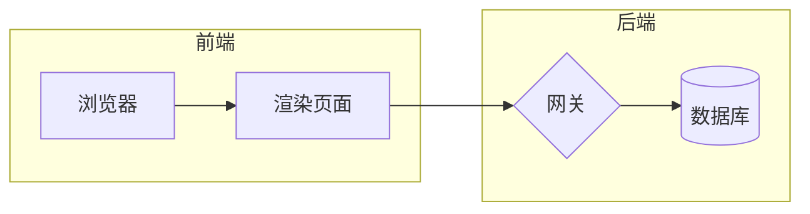

`subgraph 名字 ... end` 用来画分层/子模块，分组的方向可用内部 `direction` 指定。

## 时序图

描述对象之间的消息往来：

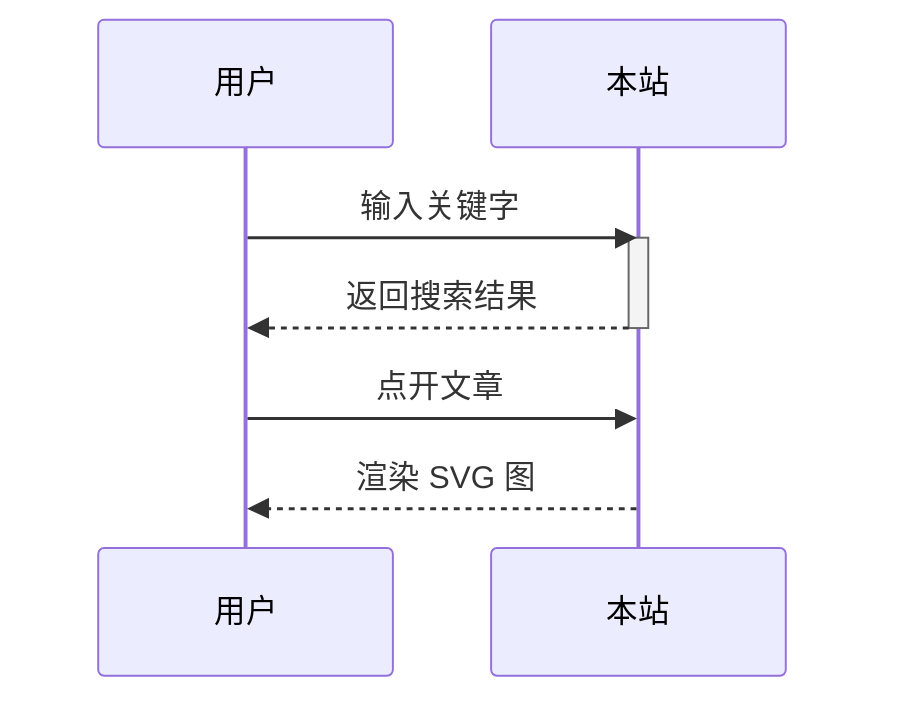

- `->>` 实线箭头，`-->>` 虚线箭头（返回）；
- `activate S ... deactivate S` 画激活条，缩写 `S->>S: 计算中` 也可以；
- 条件分支用 `alt 条件 ... else ... end`，循环用 `loop ... end`。

## 类图

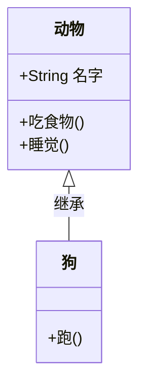

关系符号：`<|--` 继承、`<|..` 实现、`o--` 聚合、`*--` 组合、`-->` 依赖；成员前的 `+`/`-`/`#` 对应 public/private/protected。

## 状态图

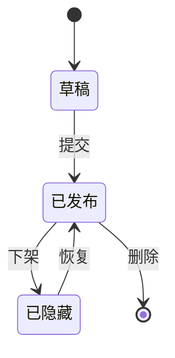

## 实体关系图（ER）

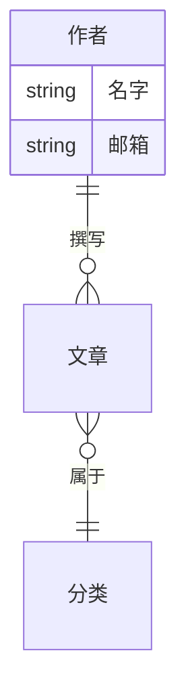

基数符号速记：`||` 恰一、`o|` 零或一、`}o` 零或多、`}o` 对多；标签里有空格要加引号。

## 甘特图

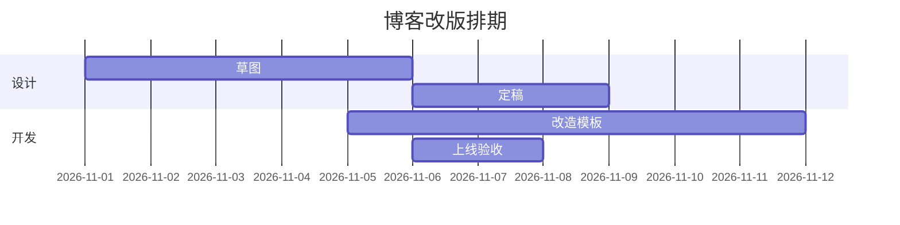

## 饼图

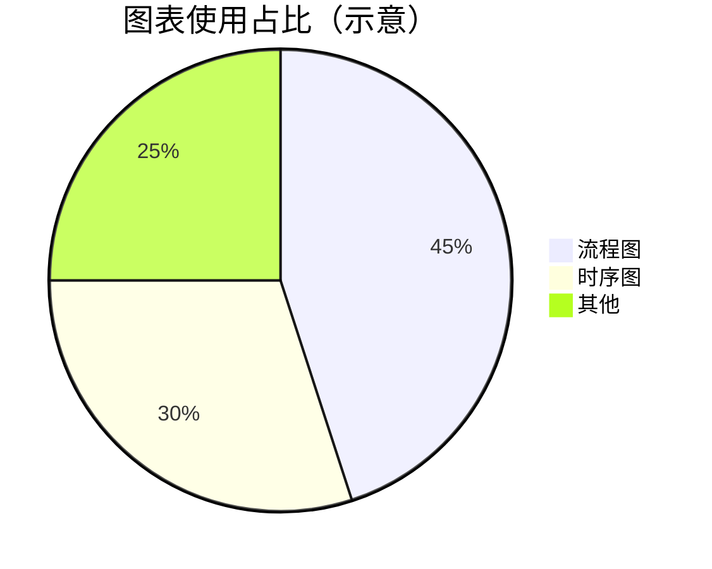

## 思维导图

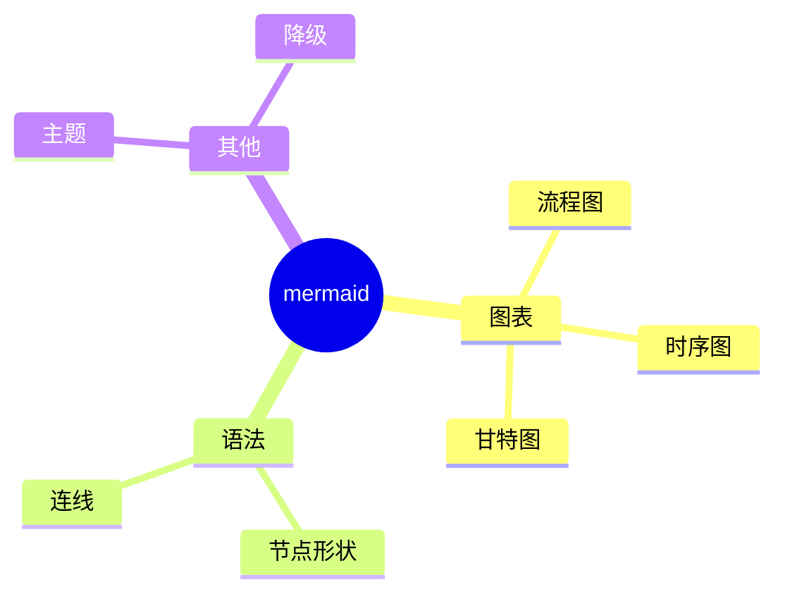

缩进嵌套，`(( ))` 表示中心的圆形节点。（mindmap 属于较新的图型，宽度策略未定制，宽了会被等比缩进正文栏。）

## Git 提交图

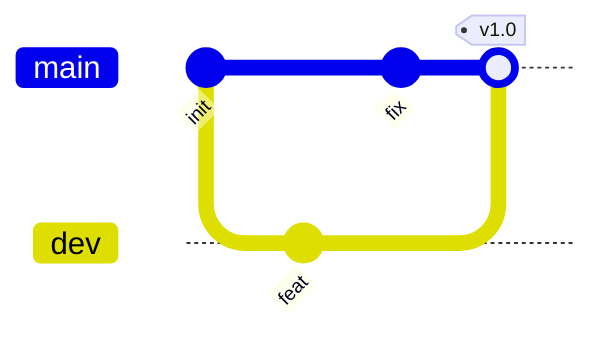

## 时间线

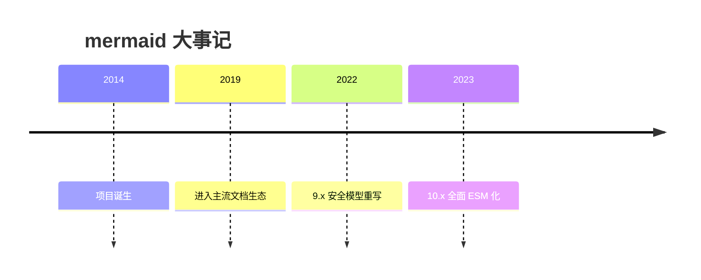

## 一些小技巧

- **中文完全可用**：节点名、连线标签、参与者都可以直接写中文；特殊字符放进引号更稳。
- **链式书写**：`A --> B --> C` 可以一路连下去，一图讲一个流程。
- **样式微调**：`style A fill:#f9f,stroke:#333` 给单节点配色；多数场景下默认主题（暗色跟随）已够用，别为颜色过度设计。
- **注释**：`%%` 开头的行是 mermaid 语法里的注释，渲染时不显示。
- **一图一意**：单图节点控制在 ~15 个以内，复杂流程拆成多张图，可读性更高。

## 注意事项

- mermaid 在**平台渲染侧**运行：文章同步到 RSS 阅读器或搜索引擎快照时看到的是普通代码块。
- 写错语法的图不会白屏，会显示错误提示和源码，方便当场发现当场改。
- 极少数实验图型（如桑基图 `sankey-beta`、`quadrantChart`、`xychart-beta`）宽度未被定制，超宽时会等比缩小；常用的流程图/时序图/甘特图等都是自然尺寸。

## 参考

- [Mermaid 官方文档](https://mermaid.js.org/intro/)
- [流程图语法](https://mermaid.js.org/syntax/flowchart.html)
- [时序图语法](https://mermaid.js.org/syntax/sequenceDiagram.html)
