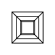
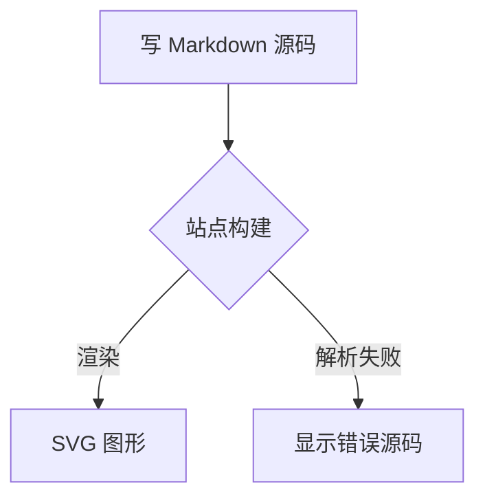
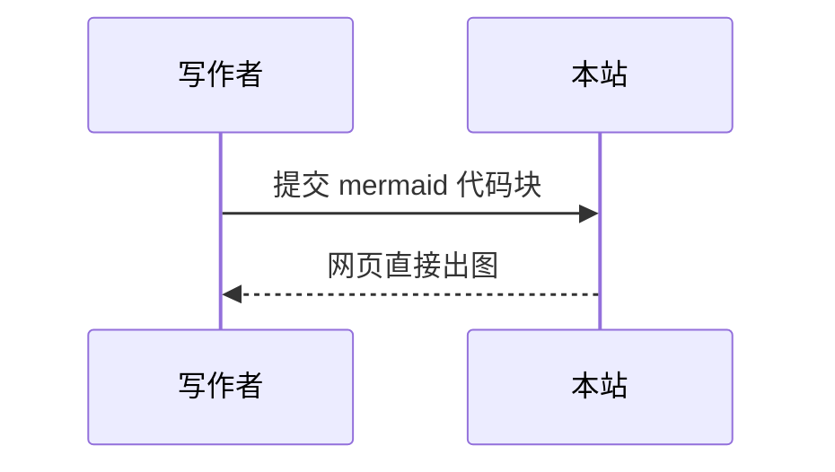

本页是本站支持的 Markdown 写法速查，每个小节的展示效果就是实际渲染结果——查看源码即可复制写法。

## 标题与正文

# Heading 1

## Heading 2

### Heading 3

#### Heading 4

##### Heading 5

###### Heading 6

正文段落里可以用常用的行内样式：**加粗**、*斜体*、~~删除线~~、`行内代码`、[超级链接](https://www.knightboy.cn/)。上标与下标用 HTML 标签：5<sup>3</sup> = 125、水是 H<sub>2</sub>O。

## 图片

文章里的图片点击可进入全屏预览（灯箱）。一篇文章有多张图时，可以左右箭头或方向键切换，`Esc` 退出。


{: .image-right}


{: .image}
一行简单文字即可插图：``，下面那行 `{: .image-right}` 控制浮动方向。

## 引用与列表

> 引用块的写法：行首加 `>`。可以多行，也可以嵌套。
>
> > 这是嵌套引用。

有序列表：

1. Item one
   1. sub item one
   2. sub item two
   3. sub item three
2. Item two

无序列表：

* Item one
* Item two
* Item three

## 表格

| Header1 | Header2 | Header3 |
|:--------|:-------:|--------:|
| cell1   | cell2   | cell3   |
| cell4   | cell5   | cell6   |

冒号的位置决定对齐方向：`:---` 居左、`:---:` 居中、`---:` 居右。

## 代码块

三个反引号开头结尾，第一个反引号后写语言名（如 `css`）。代码块右上角有语言标签，鼠标悬停出现复制按钮。

``` css
#container {
  float: left;
  margin: 0 -240px 0 0;
  width: 100%;
}
```

``` c++
std::map<std::string, int> ranks;
auto it = ranks.emplace("bob", 42);
bool ok = it.second;  /* true, 新插入。 */
```

## mermaid 图表

本站原生支持 mermaid：把代码块的语言名写成 `mermaid`，网页里会自动渲染成图形。





更多图型与写法见《Mermaid 使用教程》。

## 按钮

给链接加 `.btn` 类即可突出显示。

``` html
<a href="#" class="btn btn-success">Success Button</a>
```

<div markdown="0"><a href="#" class="btn">Primary Button</a></div>
<div markdown="0"><a href="#" class="btn btn-success">Success Button</a></div>
<div markdown="0"><a href="#" class="btn btn-warning">Warning Button</a></div>
<div markdown="0"><a href="#" class="btn btn-danger">Danger Button</a></div>
<div markdown="0"><a href="#" class="btn btn-info">Info Button</a></div>

## 键盘按键

用 `<kbd>` 标签表示键盘按键：

``` html
<kbd>W</kbd><kbd>A</kbd><kbd>S</kbd><kbd>D</kbd>
```

按 <kbd>W</kbd><kbd>A</kbd><kbd>S</kbd><kbd>D</kbd> 移动你的车。**Midtown Madness!!**

## 消息栏

在段落末尾追加 `{: .message}` 可以生成提示栏，适合放注意事项或摘要：

**注意！** 段落后加 `{: .message}` 即可生成这样的提示栏。
{: .message}
